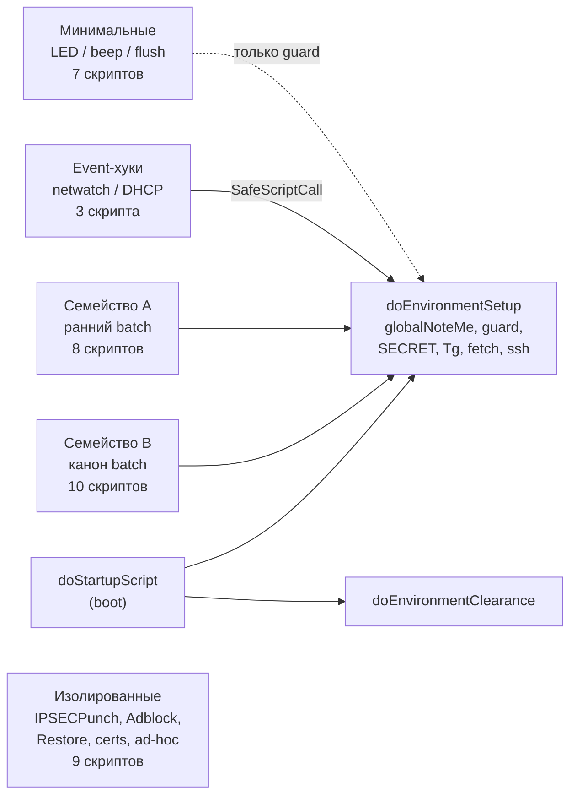
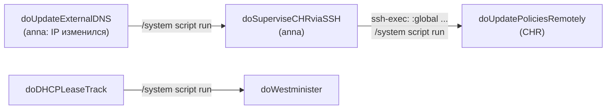
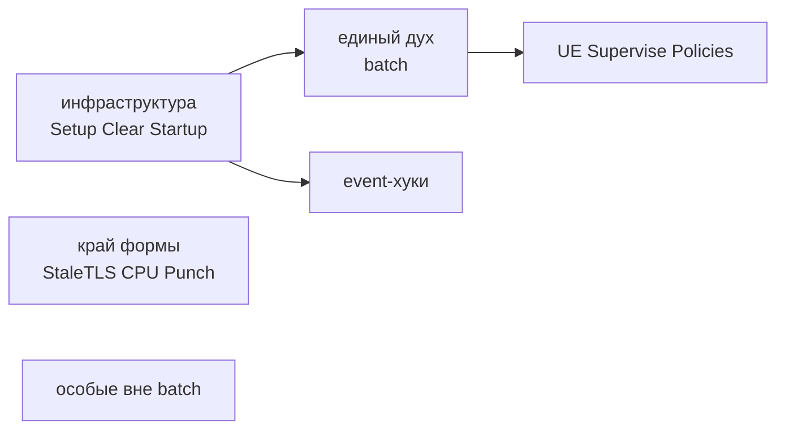

# Канон стиля RouterOS-скриптов

Документ зафиксирован рядом с кодом.

- **Раздел 0** — исходный запрос на анализ (постановка и уточнения; поправки унификации — отдельно).
- **Разделы 1–3** — **первичная итерация** анализа (снимок до/во время первой унификации). Не удалять; для новой работы по стилю на них не опираться.
- **Раздел 4** — обязательный целевой канон оформления (to-be) для новых фич и рефакторинга. Там, где раздел 2 и раздел 4 расходятся по синтаксису/форме, действует раздел 4.
- **Раздел 5** — **вторичная итерация**: стилистический анализ текущего слепка `src/scripts` (дух, манера, границы). Дальше опираться на раздел 5; `doPerfectRestore` в него не входит.

Все пути указаны относительно `src/scripts/`. Программа унификации (разделы 5–9 исходного плана) здесь не дублируется: ссылки вида «см. 5.2» относятся к ней и после завершения унификации носят исторический характер. Номер «5» у вторичной итерации ниже — раздел этого файла, не программа плана.

## 0. Запрос на анализ

Формулировки лежат в чате от 12 октября, репозиторий `mikrobackups`. Ниже они дословно, в том порядке, в котором они были написаны. После правок скриптов полный глубокий анализ повторяется по этому тексту, по текущему `src/scripts`.

**Постановка, 16:10.** Только анализ, без оптимизации и без рефакторинга в ущерб текущему стилю. Канон на ближайшие 10–15 фич — уже применённые паттерны, даже если они неэффективны или расходятся с лучшими практиками.

> Нужно исследовать текущую стилистику, манеру и подход к написанию скриптов из текущего проекта. Общий обороты, наименованиепеременных, применение средств языка характерное именно для разработчика который писал эти скрипты. На текущий моемнт и ближайщие несколько фич нужно сохранить этот подход. и не пытаться излишне оптимизировать, и применять рефакторинг в ущерб текущему стилю. Не все скрипты даже сейчас могут быть выполнены в едином духе, поэтому важно выделить только те, которые практикуют единую схемотехнику операций, формат функций, порядок выполнения и постараться существующий скрипты которые вне этого концепта все-таки "унифицировать"
> На текущий момент только анализ, и попытки выделить\сформулировать стилистику которую мы далее будем применять, даже если она неэффективная, ошибочная или не соответствует лучшим практикам. Сейчас основоый посыл в проекту - выявление уже примененных патернов разработки и следование им на протяжении следующих 10-15 фич.

**Уточнение глубины, 16:16.** После смены модели — повторный разбор того же запроса и сверка с уже составленным планом:

> Я поменял модель, сделай повторный анализ запроса и сравни с уже составленным планом, нужно сильнее\глубже\детальнее развернуть паттерны уде существующих скриптов

**Уточнения к плану, 16:33 и 16:35:**

> Схема оченьм елкая в плане, перерисуй

> Не совсем понятно, в чем именно деление на семейства, что именно отличает эти семейства, опиши в плане

**Поправки к плану унификации, 17:49.** Это уже не «только анализ»: вы задали шаги унификации и попросили поправить отмеченные строки плана `канон_стиля_routeros_6de8519e.plan.md` (287–291 и 295).

> Скорректируй план - добавь шаги в план унификации -
>
> * гард везде через переменную - $globalScriptBeforeRun $scriptname
> * нужно унифицировать сприпты, привести А и форму В
> * Minimal - тоже привести к В
> * разорвать цепочку doDHCPLeaseTrack --> doWestminister (просто не вызывать)
> * В Event-хук сделать по схеме SafeScriptCall → "doEnvironmentSetup" а не localScriptBeforeRun/localNoteMe (но сохранить "контекстный" постфикс)
> * вализировать входные глобалы в Хуках по схеме :if (!any $X) do={ ...; :error $inf }
> * doIPSECPunch — унифицировать с кодом автора и В, исправить guard, сохранить :error "skip-continue" как continue, другие Изолированные не трогай
> * config-first - тоже приведи к В
> * функцию simplercurrdatetimestr переименуй везде в globalTimestamp, SECRET в globalSecret
> * Конфигурационные константы — :local с заглавной буквы или ALLCAPS-префиксом: - приводим в обычному camelCase, да и вообще все переменные приводим к camelCase. Отказываемся от PascalCase
> * Флаги-переключатели — :local <Что>Enable true или :local use<Что> false - все такие флаги приведи к формату :local use<Что> false
> * В более старых скриптах остались литералы - поправить через globalSecret
> * Внутри do={}-closures и :do {} блоков автор часто пишет :local state ("...") заново вместо :set (shadowing)  - привести такие кейсы к :set
> * Внутри do={}-closures и :do {} блоков автор часто пишет :local state ("...") заново вместо :set (shadowing)  - унифицировать везде, использовать бесскобочный подход
> * Preflight и ранний выход - это считать хорошей манерой, и применять далее
> * Возвращаемые значения: строка-ошибка/"", true/false, либо C-style 0/1 - привести к единообразию
> * Обработка ошибок - все отрефакторить чтобы применялась более современная форма :onerror errorName in={ ... } do={ :set state "Error When $state: $errorName" ... } - переменная для  ошибки всегда errorDescr
> * Аккуратоно переработать все Gate-паттерн вместо break/continue. Раньше в языке не было возможности прервать цикл или перескочить итерацию, или в целом прервать скрипт. Изучи - в проекте есть другие практики, когда появились новые возможности в языке, в частности :error как break/continue
> * Два независимых :if - позволяет экономить когнитивную сложность, оставляем
> * Success-строка  - привести к единообразвию в виде ✓ SUCCESS / ✗ FAILED
> * Дублирование вместо выноса: SafeScriptCall  - устранить
> * Точки с запятой — смешанно внутри одного файла - привести к единообразию, везде убрать ;
> * Отступы - стандартизировать везде, применять 4 пробелма на сдвиг
> * Комментарии: # без пробела или с одним - стандартизировать одним пробелом. ## - не использовать.
> * Скобки в условиях с лишними пробелами: - унифицировать, не применять лишние пробелы
> * для Event-скриптов привести переменные GleaseBound, GleaseServerName, GleaseActMAC, GleaseActIP, Guser, NetwatchHostName и пр. в формат <global>XXX

Два пункта про shadowing вы написали подряд и по-разному: сначала «привести такие кейсы к `:set`», сразу следом «унифицировать везде, использовать бесскобочный подход».

**Граница репозитория, 17:57:**

> Этот план нужно реализовать в контекте проекта /Users/Defm/repos/mikrobackups-next,
> а не в текущем
> Как это сделать?

Дальше, уже в чате по репозиторию next, задано исполнение, а не новый анализ:

> Возьми план /Users/Defm/.cursor/plans/канон_стиля_routeros_6de8519e.plan.md и выполнить разделы 4–7 с поправками из нового раздела 8. Первым шагом — скопировать канон (разделы 1–4) в docs/style-canon.md репозитория next, чтобы он жил рядом с кодом.

## 1. Карта семейств

> **Первичная итерация.** Разделы 1–3 — исторический снимок семейств и идиом до полной унификации. Актуальная стилистическая сводка — **раздел 5**.

Кто от чего зависит (семейства, не отдельные файлы):



Состав семейств:

- **B (канон):** `doFreshTheScripts`, `doSuperviseCHRviaSSH`, `doUpdatePoliciesRemotely`, `doUpdateExternalDNS`, `doCPUHighLoadReboot`, `doPushStatsToInfluxDB`, `doCreateTrafficAccountingQueues`, `doRandomGen`, `doHeatFlag`, `doDumpTheScripts`.
- **A (ранний batch):** `doBackup`, `doCoolConsole`, `doCloudBackup`, `doFlushLogs`, `doCheckPingRate`, `doKeepScriptsOwner`, `doStaleTSLConnectionsTrack`, `doFreshDNSAddressLists`.
- **Event:** `doNetwatchHost`, `doNetwatchDNS`, `doDHCPLeaseTrack`.
- **Minimal:** `doLEDon`, `doLEDoff`, `doWestminister`, `doBumerSound`, `doSomeAlarm`, `doImperialMarch`, `flush_dns`.
- **Isolated:** `doIPSECPunch`, `doAdblock`, `doUpdateStaticDNSviaDHCP`, `doPerfectRestore`, `doCertificatesIssuing`, `doSCEPClientCertificatesIssuing`, `doHotspotLoginTrack`, `doTranstaleMAC2IP`, `doFastTrackActivation`.

Единственная межскриптовая цепочка вызовов внутри batch-семейства (RPC между роутерами):



### 1.1. По каким признакам скрипт относится к семейству

Деление — не по предметной области (backup, DNS, VPN), а по **схемотехнике выполнения**: кто и как запускает скрипт, откуда берутся глобалы, есть ли сквозной флаг результата и как скрипт заканчивается. Семь признаков, по которым различаются семейства:

1. **Точка входа** — scheduler/ручной запуск, startup, netwatch/DHCP-событие.
2. **Как получен environment** — предполагается уже существующим (глобалы просто объявлены `:global`), поднимается самим скриптом (`SafeScriptCall "doEnvironmentSetup"`), или не используется вовсе.
3. **Guard** — `$globalScriptBeforeRun $scriptname` (через переменную), `$globalScriptBeforeRun "literal"`, локальная копия, или отсутствует.
4. **Наличие `scriptname`/`sysname` как переменных** — нужны для footer-строки `"$scriptname on $sysname: ..."`.
5. **Сквозной флаг `itsOk` + накопитель `state`** — ведётся ли через весь скрипт и влияет ли на финал.
6. **Footer** — стандартный блок `inf` → `globalNoteMe` → при ошибке `globalTgMessage` + `:error`; частичный; отсутствует.
7. **Авторство/диалект** — код автора в его обычной манере, его же код в другом диалекте, или заимствованный.

**Семейство B — канон batch.** Все семь признаков в «полном» значении:

- вход: scheduler или ручной запуск;
- environment предполагается готовым: сверху столбец `:global ...`, без `SafeScriptCall`;
- первые строки файла: `:local sysname`, `:local scriptname "do..."`, `:global globalScriptBeforeRun`, `$globalScriptBeforeRun $scriptname`;
- далее дословно `:global globalNoteMe;` / `:local itsOk true;` / `:local state "";`;
- `itsOk` переключается в каждом `on-error`, последующие шаги завязаны на `:if ($itsOk)`;
- заканчивается полным footer из раздела 2.6 (`inf`, два `:if`, ленивый `:global globalTgMessage`, `:error $inf`).

Проверка принадлежности: в файле есть и `$globalScriptBeforeRun $scriptname`, и строка `"Error When $scriptname on $sysname: $state"`.

**Семейство A — ранний batch.** Тот же автор, та же логика, но хотя бы один из признаков 3–6 в «старой» или «неполной» форме:

- guard строковым литералом `$globalScriptBeforeRun "doBackup"` вместо `$scriptname`;
- `scriptname`/`sysname` объявлены позже по тексту или не объявлены (`doFlushLogs`, `doCheckPingRate`, `doCloudBackup`);
- `itsOk` либо отсутствует, либо объявлен, но не доходит до footer (`doCloudBackup`);
- footer либо полный (`doBackup` — единственный в семействе), либо отсутствует; завершение — просто последний `$globalNoteMe` или `:log`;
- `state` используется как метка шага, но без итоговой строки `inf`.

Отличие от B — только в оформлении входа/выхода; тело пишется теми же идиомами (`state` + `globalNoteMe`, трёхстрочный `on-error`, `"Done"`). Именно поэтому A — главный кандидат на унификацию под B.

**Event-хуки.** Отличаются признаками 1 и 2, и это принципиально:

- вход — netwatch `up/down` или DHCP `lease-script`, под системным пользователем `*sys`, где глобалы могут быть ещё не созданы;
- данные приходят через внешние глобалы с заглавной буквы (`NetwatchHostName`, `GleaseActIP`), которые надо снять в `local...` первой строкой — скрипт может быть вызван дважды подряд;
- environment поднимается самим скриптом: локальный `SafeScriptCall` → `"doEnvironmentSetup"`, и только после этого `:global globalNoteMe`;
- guard — после bootstrap (`doDHCPLeaseTrack`), отсутствует (`doNetwatchHost`) или заменён локальной копией `localScriptBeforeRun`/`localNoteMe` (`doNetwatchDNS`);
- нет `itsOk`, нет footer: результат — одно сообщение `globalTgMessage`/`:log warning` и выход; валидация входных глобалов через `:if (!any $X) do={ ...; :error $inf }`.

Особенность, которую нужно сохранить при унификации: bootstrap environment должен произойти **до** первого обращения к глобальным helper'ам, а внешние глобалы — сняты в locals **до** bootstrap. Целевая схема — в 4.3.

**Минимальные.** Признаки 4–6 отсутствуют намеренно:

- вход — scheduler (`doLEDon`/`doLEDoff`, `flush_dns`) или вызов из другого скрипта (`doWestminister` из `doDHCPLeaseTrack`, `doImperialMarch` из `doStartupScript`);
- содержимое — guard (где есть) + одна команда или серия `:beep`/`:delay`;
- нет `globalNoteMe`, нет `state`, нет footer;
- у `doImperialMarch` и `doEnvironmentClearance` нет даже guard, потому что они вызываются до/во время bootstrap.

Решение (раздел 5.3): привести к форме B целиком, включая footer; появление сообщений в логе/Telegram принимается как ожидаемое поведение.

**Изолированные.** Выпадают по признаку 7, остальные признаки произвольны:

- `doIPSECPunch` — код автора, но другой диалект: шапка `# === SECTION ===`, map-конфиг `Config`, `Stats`, локальный `Log` с уровнями, PascalCase-функции с 5–7 позиционными аргументами, `:error "skip-continue"` как `continue`; при этом guard есть, но с чужим именем;
- `doAdblock` (StopAD), хвост `doFreshDNSAddressLists` (`$update`), `doUpdateStaticDNSviaDHCP` — заимствованный код с собственным стилем логирования и конфиг-блоками;
- `doPerfectRestore`, `doFastTrackActivation` — одноразовые recovery/CLI-последовательности без каркаса;
- `doCertificatesIssuing`, `doSCEPClientCertificatesIssuing` — ручные генераторы с config-first заголовком, `itsOk` объявлен, но не используется, один большой `:do {} on-error={}` без footer;
- `doHotspotLoginTrack`, `doTranstaleMAC2IP` — отладочные наброски (`:put`, захардкоженные MAC, `foreach`/`if` без `:`).

Их объединяет только то, что они не являются образцом стиля. Решение: `doIPSECPunch` и оба cert-скрипта приводятся к форме B (5.4, 5.5); остальные остаются как есть.

**Runtime и bootstrap** (`doEnvironmentSetup`, `doEnvironmentClearance`, `doStartupScript`) — не семейство скриптов-задач, а инфраструктура: там действуют свои шаблоны (ленивая инициализация `:if (!any $globalX)`, `SafeScriptCall`-цепочка, NTP-ожидание прямыми `:log`/`:put` до появления `globalNoteMe`).

Основной канон для новых фич — **семейство B**. Семейство A — тот же автор, более ранняя форма заголовка; поведенчески совместимо, стилистически отстаёт на 1–2 шага.

## 2. Каталог идиом as-is (как написано сейчас)

Этот раздел описывает исходное состояние. Целевые правила — в разделе 4; где они расходятся с as-is, действует раздел 4.

### 2.1. Заголовок: три формы

**Форма B (актуальная, целевая для новых скриптов).** Файл начинается с пустой строки. Сначала `sysname`, затем `scriptname` литералом, затем guard через переменную:

```routeros

:local sysname [/system identity get name];
:local scriptname "doSuperviseCHRviaSSH";
:global globalScriptBeforeRun;
$globalScriptBeforeRun $scriptname;

:global globalNoteMe;
:local itsOk true;
:local state "";
```

Так написаны [`doFreshTheScripts`](src/scripts/doFreshTheScripts.rsc.txt), [`doSuperviseCHRviaSSH`](src/scripts/doSuperviseCHRviaSSH.rsc.txt), [`doUpdatePoliciesRemotely`](src/scripts/doUpdatePoliciesRemotely.rsc.txt), [`doUpdateExternalDNS`](src/scripts/doUpdateExternalDNS.rsc.txt), [`doCPUHighLoadReboot`](src/scripts/doCPUHighLoadReboot.rsc.txt), [`doPushStatsToInfluxDB`](src/scripts/doPushStatsToInfluxDB.rsc.txt), [`doCreateTrafficAccountingQueues`](src/scripts/doCreateTrafficAccountingQueues.rsc.txt), [`doHeatFlag`](src/scripts/doHeatFlag.rsc.txt). Порядок четырёх строк блока деклараций (`globalNoteMe` → `itsOk` → `state`) повторяется дословно.

**Форма A (ранняя).** Guard строковым литералом, `scriptname`/`sysname` объявляются позже или не объявляются:

```routeros
:global globalScriptBeforeRun;
$globalScriptBeforeRun "doBackup";
```

[`doBackup`](src/scripts/doBackup.rsc.txt), [`doCoolConsole`](src/scripts/doCoolConsole.rsc.txt), [`doCloudBackup`](src/scripts/doCloudBackup.rsc.txt), [`doFlushLogs`](src/scripts/doFlushLogs.rsc.txt), [`doCheckPingRate`](src/scripts/doCheckPingRate.rsc.txt), [`doKeepScriptsOwner`](src/scripts/doKeepScriptsOwner.rsc.txt), [`doStaleTSLConnectionsTrack`](src/scripts/doStaleTSLConnectionsTrack.rsc.txt), [`doFreshDNSAddressLists`](src/scripts/doFreshDNSAddressLists.rsc.txt), все minimal-скрипты.

**Форма C (config-first).** Предметные константы идут до guard: [`doCertificatesIssuing`](src/scripts/doCertificatesIssuing.rsc.txt), [`doSCEPClientCertificatesIssuing`](src/scripts/doSCEPClientCertificatesIssuing.rsc.txt), а также [`doDumpTheScripts`](src/scripts/doDumpTheScripts.rsc.txt) с комментарием `# CONFIG` первой строкой.

Целевая форма — B для всех скриптов унифицируемых семейств (раздел 5).

### 2.2. Блок деклараций и конфигурации

- Остальные глобалы (`globalCallFetch`, `globalCallSSH`, `SECRET`, `simplercurrdatetimestr`, `globalOnPrimaryPartition`) объявляются сразу после guard одним столбцом. Исключение, которое является приёмом: **`:global globalTgMessage` объявляется лениво внутри footer** в `:if (!$itsOk)`, а не сверху. Сверху он есть только в `doDumpTheScripts`, `doIPSECPunch`, `doFreshDNSAddressLists`, event-скриптах.
- Конфигурационные константы — `:local` с заглавной буквы или ALLCAPS-префиксом: `FTPServer`, `FTPPort`, `FTPRoot`, `SMTPAddress`, `SMTPSubject`, `RamWarnLimit`, `CpuWarnLimit`, `ListName`, `ListTimeout`, `Interval`, `BackupPassword`, `UpdateList`, `GitHubUserName`, `RAMDiskName`, `KEYSIZE`, `COUNTRY`.
- Флаги-переключатели — `:local <Что>Enable true` или `:local use<Что> false` / `:local save<Что> true`: `FTPEnable`, `FTPGitEnable`, `SMTPEnable`, `SSHFSEnable`, `useBandwidthTest`, `saveSysBackup`, `encryptSysBackup`, `verboseRawExport`, `progressiveDelay`, `impersonate`, `UseUpdateList`.
- Над константой — однострочный `#`-комментарий с объяснением: `#directories have to exist!`, `#available (free) resource (percent), set it to 90 for testing`, `# sshfs disk dramatically SLOOOOOOWS any '/file find' operations`.
- Секреты — всегда через интерполяцию в строке: `:local FTPServer "$[$SECRET get SSH_SERVER]"`. В более старых скриптах остались литералы (`doSuperviseCHRviaSSH`: `185.13.148.14`/`2223`/`automation`; `doPushStatsToInfluxDB`: токен). Не выносить в `SECRET` без задачи.
- Runtime-переменные — camelCase: `itsOk`, `state`, `inf`, `wanIp`, `fetchCmd`, `remoteCommand`, `errorDef`, `buFile`, `stamp`, `payLoad`, `skip`, `ticks`.

### 2.3. Повествование через `state` + `globalNoteMe`

Строго две строки, всегда раздельно, никогда inline:

```routeros
:set state "Making SFTP backdoor for $wanIp via SSH"
$globalNoteMe value=$state
```

- После успешного шага — буквально `$globalNoteMe value="Done"` (без `state`).
- `state` хранит «метку текущего шага», чтобы в `on-error` обернуть её: `:set state "Error When $state"`. Это главная причина, почему `state` переназначается перед каждым действием.
- Внутри `do={}`-closures и `:do {}` блоков автор часто пишет `:local state ("...")` заново вместо `:set` (shadowing) — `doEnvironmentSetup`, `doCertificatesIssuing`, `doUpdatePoliciesRemotely` в `on-error`. Оба варианта считать нормой.
- Скобочная и бесскобочная форма чередуются: `:set state ("Checking...")` и `:set state "Checking..."`.
- Тон сообщений — разговорный, первое лицо: `I'm now putting: ...`, `goind deeper..`, `Got it`, `Got it at last. Exporting to file`, `Waiting backdoor for $wanIp for some seconds..`, `tracking..`. Многоточие в две точки `..` чаще, чем в три.
- `:log error $state` добавляется к `globalNoteMe` только для preflight-WARNING; `:log warning` — в event-контексте и при алертах `doCheckPingRate`.

### 2.4. Preflight и ранний выход

```routeros
:global globalOnPrimaryPartition;
:if ( ![$globalOnPrimaryPartition] ) do={
    :set state "WARNING: the system booted up from fallback partition - skipping backup!"
    :log error $state
    $globalNoteMe value=$state;
    :set itsOk false;
    :error $state;
}
```

- Сообщение начинается с `WARNING: ... - skipping <что>!`.
- Выход через `:error $state` **до** footer, Telegram не отправляется. Это осознанный «тихий» отказ.
- Проверка доступности сервера — `:do { :local x [:resolve "$FTPServer"]; } on-error={ ... }` с результатом, который никуда не используется.
- `doDumpTheScripts` делает цепочку из 3–4 таких preflight подряд (partition, tmpfs, sshfs, FTP).

### 2.5. Обработка ошибок

**Базовая форма** (тело `on-error` всегда три строки):

```routeros
:do {
    :set state "Uploading $buFile to FTP ($FTPRoot$buFile)"
    $globalNoteMe value=$state
    ...
    $globalNoteMe value="Done"
} on-error={
    :set state "Error When $state"
    $globalNoteMe value=$state;
    :set itsOk false;
}
```

**Новая форма** (появляется в более поздних скриптах и в `doEnvironmentSetup`): `:onerror errorDescr in={ ... } do={ :set state "Error When $state: $errorDescr" ... }`. Исторически в тексте встречались и другие имена (`errorName` / `err`); **канон (раздел 4) — только `errorDescr`**.

**Gate-паттерн вместо break/continue.** Последовательные шаги оборачиваются в `:if ($itsOk) do={ :do { ... } }`; в циклах — per-item флаг `skip`:

```routeros
:local skip false;
...
:if ( $itsOk and !$skip) do={
    :do { ... } on-error= { ...; :set skip true; }
}
:if ( $itsOk and !$skip) do={
    ...
}
```

`doFreshTheScripts`, `doPushStatsToInfluxDB`, `doCreateTrafficAccountingQueues`, `doSuperviseCHRviaSSH` (три `:if ($itsOk) do={ :do {...} }` подряд).

**Конвенция helper'ов «пустая строка = успех».** `callSSH` / `globalCallSSH` возвращают `""` при успехе и текст ошибки иначе; вызывающий код:

```routeros
:local errorDef [$globalCallSSH $remoteCommand];
:if ([:len $errorDef] > 0) do={
    :set state $errorDef;
    $globalNoteMe value=$state;
    :set itsOk false;
} else={
    :set state "Success RPC call: $state";
    $globalNoteMe value=$state;
}
```

**`:error` как break/continue** внутри `:onerror`/`:do`: `:error "break-loop"` (`doNetwatchDNS`), `:error "skip-continue"` (`doIPSECPunch`), `:error "primary active"` (`globalOnPrimaryPartition`). Результат читается через `$errorName` в `do={}`.

**Пустые ветки-заглушки** с комментарием: `} else={ }`, `} else={ # success }`, `on-error={ }`. Сохраняются.

**`:error` как нормальный выход**: `doKeepScriptsOwner` завершает `:error "No scripts and schedules owner change needed"`. Scheduler видит это как failure — сознательный компромисс.

### 2.6. Footer: точная форма

Два **независимых** `:if`, не `if/else`; `inf` объявляется пустым; Telegram-глобал — лениво внутри ветки ошибки; завершение `:error $inf`:

```routeros
:local inf ""
:if ($itsOk) do={
  :set inf "$scriptname on $sysname: remote policies refreshed Successfully"
}

:if (!$itsOk) do={
  :set inf "Error When $scriptname on $sysname: $state"  
}

$globalNoteMe value=$inf

:if (!$itsOk) do={

  :global globalTgMessage;
  $globalTgMessage value=$inf;
  :error $inf; 
 
}
```

- Отступ footer — 2 пробела, даже если тело скрипта на 4. Пустая строка после `:if (!$itsOk) do={` и перед `}`. Trailing spaces после `:set inf "..."  ` в большинстве файлов.
- Success-строка — прошедшее время + «Successfully»/«Succesfully» (опечатка чередуется между файлами): `Automatic Backup Completed Successfully`, `scripts refreshed Successfully`, `stats pushed Succesfully`, `refreshed traffic accounting queues Succesfully`, `cpu load ok`.
- Варианты той же формы:
  - три ветки через дополнительный флаг `payLoad` (`doUpdateExternalDNS`: «change detected, refreshed» / «no update needed» / Error);
  - `Warn When ...` + `/system reboot` вместо `:error` (`doCPUHighLoadReboot`);
  - `summary` с `✓ SUCCESS` / `✗ FAILED - $state` вместо `inf` (`doDumpTheScripts`, единичное отклонение);
  - повторное `:set inf` внутри ветки ошибки перед Telegram (`doPushStatsToInfluxDB`, строка 163 — убирает префикс «Error When» для Tg).
- Footer отсутствует у семейства A кроме `doBackup`, у event и minimal.

### 2.7. Циклы и menu-контексты

- Итерация по ID с последующим `get` каждого свойства, а не `as-value`:

```routeros
:foreach backupFile in=[/file find] do={
  :set buFile ([/file get $backupFile name])
  ...
}
```

- Переключение menu-контекста строкой `/queue simple` или `/ip dhcp-server lease`, после чего внутри цикла голые `get $z`, `set $y ...`, `remove $z`, `reset-counters $z` без пути. Либо скобочный блок `/ip ipsec policy { :foreach ... }` (`doUpdatePoliciesRemotely`, `doCoolConsole`).
- Имена loop-переменных: однобуквенные `x`, `y`, `z`, `i`, `j` для вложенных циклов; осмысленные `scriptId`, `backupFile`, `vpnEndpoint`, `thePeer`, `memAction`, `schEndpoint` для одиночных. Префикс `the` — характерная черта: `theScript`, `thePeer`, `thePass`.
- `:for i from=1 to=$ticks do={` с ручными счётчиками; `:while` с внешним флагом `break`; бесконечный `:do { ... } while=(true)` с heartbeat-счётчиком (`doStaleTSLConnectionsTrack`).
- Извлечение IP из target очереди — дословно повторяемый кусок:

```routeros
:if ( ($qIp->0) != nil ) do={
  :set qIp ($qIp->0) 
  :set qIp ( [:pick $qIp 0 [:find $qIp "/" -1]] ) ;
} else {
  :set skip true;
}
```

(`else {` без `=` — тоже воспроизводится в двух файлах).

### 2.8. Helper-функции

- Глобальные сервисы живут только в [`doEnvironmentSetup`](src/scripts/doEnvironmentSetup.rsc.txt) по шаблону ленивой инициализации:

```routeros
:global globalX;
:if (!any $globalX) do={
  :global globalX do={
    :global globalNoteMe;
    ...
  }
}
```

  Перед функцией — блок `#Example call` с готовой строкой вызова.

- Локальные helper'ы объявляются в теле скрипта до использования, camelCase или PascalCase без системы: `callSSH`, `checkDisk`, `searchReplace`, `detectSilentTLSBlock`, `SafeScriptCall`, `SafeResolve`, `WaitForFile`.
- Аргументы локальных helper'ов — позиционные с явным распаковыванием в первых строках и комментарием `# reading params`: `:local cmd $1;`, `:local targetName $1`, `:local targetType $2`. Проверка наличия — `:if ([:len $0]!=0) do={ :if ([:len $1]!=0) do={`.
- Именованные аргументы — только у глобальных: `value=`, `ip=`, `mac=`, `argClients=`, `ListName=`. Внутри глобалов `:global globalNoteMe;` переобъявляется в начале каждой функции.
- Возвращаемые значения: строка-ошибка/`""`, `true/false`, либо C-style `0/1` (`checkDisk` возвращает `0` при успехе).
- Дублирование вместо выноса: `SafeScriptCall` трижды (отличие — только `(NETWATCH context)`/`(DHCP context)` в логах), блок определения `rosVer`/`sysver` трижды, `callSSH` локально в `doSuperviseCHRviaSSH` при наличии `globalCallSSH`. Это осознанная изоляция, а не недосмотр.

### 2.9. Удалённое выполнение и команды-строки

- Команда формируется строкой и передаётся дальше, прямой вызов `/tool fetch upload=yes` в теле скрипта не используется. SFTP-upload одного файла — `$globalCallSftp src= dst=` ([docs/operations/fetch.md](operations/fetch.md)), не `$globalCallFetch`:

```routeros
:local errorDef [$globalCallSftp $buFile $dst]
:if ([:len $errorDef] > 0) do={ :error $errorDef }
```

  Строковый вызов остаётся у `$globalCallFetch` для прочих команд (HTTPS, FTP на localhost, `:import`).

- Удалённая команда для SSH — в фигурных скобках одной строкой: `:local remoteCommand "{ /ip/firewall/address-list remove [...]; /ip/firewall/address-list/add ... }"`.
- Async через `[:execute script=$Cmd]` / `[:execute file=... script=...]` с опросом `/system script job find where .id=$jobid` и `:delay 1s`.
- RPC между роутерами — установка глобалов на удалённой стороне строкой `":global globalRemoteIp $wanIp/32"`, затем `/system script run doUpdatePoliciesRemotely`.
- Ритуал «knock» перед массовым SFTP: `alist-fw-knockknock` + `:delay 15s` с комментарием про бан.

### 2.10. Задержки

Жёсткие литералы с объясняющим комментарием: `:delay 2s` после backup, `:delay 6s` после подписи сертификата, `:delay 7s` после `force-update`, `:delay 15s` после e-mail (`#email works in background, delay needed`) и после knock. Иногда без суффикса: `:delay 5;`, `:delay ($delaySec);`. Не заменять на polling.

### 2.11. Строки и сборка текста

- Интерполяция `"$var"` предпочтительнее конкатенации; конкатенация `.` — для сборки имён с суффиксами: `($fname.".backup")`, `($dhcpComment . "@" . $dhcpServer . " (" . $dhcpMac . ")")`.
- Вызов функции внутри строки: `"$[$SECRET get SSH_SERVER]"`, `"$[/system resource get uptime]"`.
- Многострочные буферы для автозапуска — `"\r\` + `\n ...\r\` построчно с экранированием `\$` (`doKeepScriptsOwner`).
- `\?` в URL Telegram/Influx; `:convert to=url` для шаблонов; URL-encoded emoji в тексте Tg.
- Ручная сборка дашборда через пару `logcontenttemp`/`logcontent` с `." \n"` (`doCoolConsole`).

### 2.12. Форматирование

- Точки с запятой — смешанно внутри одного файла: после `:local`/`:global`/`$globalNoteMe` чаще есть, после `:set` чаще нет. `doDumpTheScripts` — почти без `;`. Нормализовать не нужно.
- Отступы: семейство A и footer'ы — 2 пробела; семейство B и новые файлы — 4; местами смешано (`doBackup`, `doPushStatsToInfluxDB`).
- Пустая строка сразу после `{` и перед `}` в крупных блоках; пустые строки между логическими шагами; 3–5 пустых строк в конце файла.
- Комментарии: `#` без пробела или с одним; `##` для «документационных» в cert-скриптах; `# === SECTION ===` только в `doIPSECPunch`. Русский встречается в `doStaleTSLConnectionsTrack`, `doDumpTheScripts`, `doIPSECPunch`. Закомментированные альтернативы оставляются рядом с рабочим кодом.
- Скобки в условиях с лишними пробелами: `:if ( [ :len [ /system package find where ... ] ] > 0 and $rosVer = 6 ) do={`.

### 2.13. Event-контексты (Netwatch / DHCP)

```routeros
# fill it inside netwatch script
:global NetwatchHostName;
:global NetwatchHostState;

# This script may be triggered twice (or more) per moment, so push down Globals as fast as we can, before they're overwritten
:local localNetwatchHostName $NetwatchHostName;
:local localNetwatchHostState $NetwatchHostState;

:local SafeScriptCall do={ ... }
# init globals as far as we are inside *sys user account
$SafeScriptCall "doEnvironmentSetup";
```

- Внешние глобалы с заглавной `G`/именем источника: `GleaseBound`, `GleaseServerName`, `GleaseActMAC`, `GleaseActIP`, `Guser`, `NetwatchHostName`. Снимок в `local<Имя>` первой же строкой.
- Порядок строго: снять глобалы → `SafeScriptCall "doEnvironmentSetup"` → (опционально) guard → объявить `globalTgMessage`/`globalNoteMe` → валидация `:if (!any $X) do={ ...; :error $inf; }`.
- `doNetwatchDNS` держит локальные копии `localNoteMe`/`localScriptBeforeRun` с текстом `(NETWATCH context)` — не сливать с глобальными.
- `doDHCPLeaseTrack` собирает `Data` как map и сериализует `:serialize to=json` — единственное место с JSON; результат не используется дальше.

### 2.14. Minimal-скрипты

Guard + одна команда, без `globalNoteMe`:

```routeros
:global globalScriptBeforeRun;
$globalScriptBeforeRun "doLEDon";

/system leds settings set all-leds-off=never;
```

Beep-скрипты: комментарий с нотами (`# E-660 D-588 C-528 G-396`), пары `:beep`/`:delay`. `doImperialMarch` и `doEnvironmentClearance` — без guard (вызываются из startup).

## 3. Эталоны для копирования при новой фиче

- Периодический job с внешним I/O (fetch/SFTP/e-mail): [`doBackup`](src/scripts/doBackup.rsc.txt) (тело) + заголовок формы B из [`doSuperviseCHRviaSSH`](src/scripts/doSuperviseCHRviaSSH.rsc.txt).
- Цепочка RPC/SSH-вызовов: [`doSuperviseCHRviaSSH`](src/scripts/doSuperviseCHRviaSSH.rsc.txt).
- Обход объектов с per-item skip и push наружу: [`doPushStatsToInfluxDB`](src/scripts/doPushStatsToInfluxDB.rsc.txt).
- Синхронизация двух таблиц (создать/обновить/удалить stale): [`doCreateTrafficAccountingQueues`](src/scripts/doCreateTrafficAccountingQueues.rsc.txt).
- Порог + повторные замеры + действие: [`doCPUHighLoadReboot`](src/scripts/doCPUHighLoadReboot.rsc.txt).
- Детект изменения + условный footer на три исхода: [`doUpdateExternalDNS`](src/scripts/doUpdateExternalDNS.rsc.txt).
- Долгоживущий монитор: [`doStaleTSLConnectionsTrack`](src/scripts/doStaleTSLConnectionsTrack.rsc.txt).
- Новый глобальный helper: любой блок `:if (!any $globalX)` в [`doEnvironmentSetup`](src/scripts/doEnvironmentSetup.rsc.txt) + `#Example call`.
- Event-хук: [`doDHCPLeaseTrack`](src/scripts/doDHCPLeaseTrack.rsc.txt).
- Одноразовое действие по расписанию: [`doLEDon`](src/scripts/doLEDon.rsc.txt).

Не брать за образец: `doAdblock`, `doUpdateStaticDNSviaDHCP`, `doPerfectRestore`, встроенный `$update` в хвосте `doFreshDNSAddressLists`. `doIPSECPunch` — образец только для приёма `:error "skip-continue"` (до его унификации по 5.4).

Эталоны выше описывают структуру и порядок операций; оформление (имена, `:onerror`, footer, отступы) при копировании берётся из раздела 4, а не из текущего текста эталона.

## 4. Целевой канон (to-be)

База — форма B из 2.1 с поправками ниже. Там, где раздел 2 и раздел 4 расходятся, действует раздел 4.

### 4.1. Заголовок и декларации

```routeros
:local sysname [/system identity get name]
:local scriptname "doExample"
:global globalScriptBeforeRun
$globalScriptBeforeRun $scriptname

:global globalNoteMe
:global globalTgMessage
:global globalSecret
:global globalTimestamp
:global globalCallFetch
:global globalCallSSH
:local itsOk true
:local state ""
```

- Guard — всегда `$globalScriptBeforeRun $scriptname`; строковых литералов в guard не остаётся.
- Все используемые глобалы объявляются одним столбцом сверху. Ленивое `:global globalTgMessage` внутри footer (as-is 2.2) заменяется объявлением в заголовке.
- Переименования глобальных helper'ов: `SECRET` → `globalSecret`, `simplercurrdatetimestr` → `globalTimestamp`, `Gltesec` → `globalFetchWaitTicks`. Все остальные `global*` уже соответствуют.
- Хранимый в `/ppp secret` маркер `comment="used by \$SECRET"` и фильтр `print where comment~"\\\$SECRET"` — это данные на устройствах; оставить маркер как есть, в коде `globalSecret` менять только имя функции и help-текст.

### 4.2. Именование

- Все переменные — camelCase, включая конфигурационные константы и локальные функции. PascalCase и ALLCAPS не используются: `FTPServer` → `ftpServer`, `FTPRoot` → `ftpRoot`, `SMTPAddress` → `smtpAddress`, `RamWarnLimit` → `ramWarnLimit`, `ListName` → `listName`, `BackupPassword` → `backupPassword`, `UpdateList` → `updateList`, `GitHubUserName` → `gitHubUserName`, `RAMDiskName` → `ramDiskName`, `KEYSIZE` → `keySize`, `COUNTRY` → `country`, `IDs` → `ids`, `SafeResolve` → `safeResolve`, `WaitForFile` → `waitForFile`, `IPCalc` → `ipCalc`, `Config` → `config`, `Stats` → `stats`.
- Аббревиатуры внутри camelCase пишутся как слово: `wanIp`, `ftpUrl`, `sshPort`, `dhcpMac`.
- Флаги-переключатели — только `use<Что>`; текущие значения по умолчанию сохраняются: `FTPEnable` → `useFtp`, `FTPGitEnable` → `useFtpGit`, `SMTPEnable` → `useSmtp`, `SSHFSEnable` → `useSshfs`, `saveSysBackup` → `useSysBackup`, `encryptSysBackup` → `useEncryption`, `verboseRawExport` → `useVerboseRawExport`, `progressiveDelay` → `useProgressiveDelay`, `impersonate` → `useImpersonation`, `UseUpdateList` → `useUpdateList`, `useBandwidthTest` — без изменений.
- Служебные имена остаются: `sysname`, `scriptname`, `itsOk`, `state`, `inf`, `skip`, `stamp`, `asyncCmd`, `errorDef`. Loop-переменные `x`, `y`, `z`, `i` и префикс `the` допустимы.
- Внешние глобалы event-хуков — с префиксом `global`: `GleaseBound` → `globalLeaseBound`, `GleaseServerName` → `globalLeaseServerName`, `GleaseActMAC` → `globalLeaseActMac`, `GleaseActIP` → `globalLeaseActIp`, `Guser` → `globalHotspotUser`, `NetwatchHostName` → `globalNetwatchHostName`, `NetwatchHostState` → `globalNetwatchHostState`. Снимок в locals: `:local netwatchHostName $globalNetwatchHostName`.
- Секреты и учётные данные — только через `"$[$globalSecret get KEY]"`. Имена ключей — из `docs/security/credentials.md` и `docs/script-audit.md`: `SSH_SERVER`, `SSH_PORT`, `SSH_USER`, `SSH_PASSWORD` (`doBackup`, `doDumpTheScripts`, `globalCallSSH`; `doSuperviseCHRviaSSH` переходит на `globalCallSSH`), `INFLUXDB_TOKEN`, `INFLUXDB_USER`, `INFLUXDB_PASSWORD` (`doPushStatsToInfluxDB`), `BANDWIDTH_TEST_USER`, `BANDWIDTH_TEST_PASSWORD` (`doCollectSpeedStats`, `doPushStatsToInfluxDB`), `BACKUP_PASSWORD` (`doCloudBackup`), `CERTIFICATE_EXPORT_PASSPHRASE` (cert-скрипты, `globalNewClientCert`), `TELEGRAM_TOKEN`, `TELEGRAM_CHAT_ID` (`globalTgMessage`). IP/хосты (CHR, SCEP URL, mynetname) — не секреты; остаются camelCase-константами в заголовке.

### 4.3. Структура выполнения

Порядок стадий фиксирован: заголовок → конфиг-константы → preflight → основная работа → footer.

**Preflight и ранний выход** — хорошая манера, применять в каждом скрипте, где есть внешняя зависимость (partition, диск, DNS, сервис):

```routeros
:global globalOnPrimaryPartition
:if (![$globalOnPrimaryPartition]) do={
    :set state "WARNING: the system booted up from fallback partition - skipping backup!"
    :log error $state
    $globalNoteMe value=$state
    :error $state
}
```

**Шаг работы** — две строки `state`/`globalNoteMe`, действие, `"Done"`. Внутри блоков и closures только `:set state "..."` без скобок; `:local state` переобъявляется один раз в заголовке скрипта или в начале функции.

**Обработка ошибок** — единственная форма. Имя переменной ошибки **всегда** `errorDescr` (в том числе во вложенных `:onerror`; не `err`, `errName`, `errorName`, `errUpd`, `errAdd`):

```routeros
:onerror errorDescr in={
    :set state "Uploading $buFile to FTP ($ftpRoot$buFile)"
    $globalNoteMe value=$state
    $globalCallFetch $asyncCmd
    $globalNoteMe value="Done"
} do={
    :set state "Error When $state: $errorDescr"
    $globalNoteMe value=$state
    :set itsOk false
}
```

По RouterOS manual: `:onerror <var> in={...} do={...}` пишет детали ошибки в **локальную** `<var>`; `do={}` видит её только если имя задано до `do` (порядок параметров важен). Вложенные `:onerror errorDescr` — штатный приём проекта (`doBackup`, `doNetwatchDNS`): при soft-catch текст сразу кладётся в `$state` внутри внутреннего `do={}`; при необходимости проброса наружу — `:error $errorDescr` (как в NetwatchDNS с `break-loop`). Отдельные имена (`errUpd`) технически изолируют soft-ошибку от внешнего биндинга, но **не канон**: канон — одно имя `errorDescr` + не читать `$errorDescr` во внешнем `in={}` после soft-catch (источник истины после catch — `$state`).

`:do { } on-error={ }` не используется. Доступно на всех текущих устройствах 7.2x; `LivingRoomWAP` (ROS 6) и снимок `mikrouter` 7.15 вне поддержки.

**Break / continue / ранний выход** — через `:error` с маркером вместо флагов `skip` и gate-цепочек `:if ($itsOk and !$skip)`. В проекте этот приём уже появился вместе с новыми возможностями языка: `:error "break-loop"` в `doNetwatchDNS`, `:error "skip-continue"` в `doIPSECPunch`, `:retry` в `doFreshDNSAddressLists`, `:onerror` в `doDumpTheScripts`. Целевая форма для итерации:

```routeros
:foreach z in=[find where comment~"$queueCommentMark"] do={
    :onerror errorDescr in={
        :local ip ([get $z target]->0)
        :if ([:typeof $ip] = "nil") do={
            :set state "Cant locate queue target IP. Skip it."
            $globalNoteMe value=$state
            :error "skip-continue"
        }
        ...
    } do={
        :if (!($errorDescr ~ "^skip-continue")) do={
            :set state "Error When $state: $errorDescr"
            $globalNoteMe value=$state
            :set itsOk false
        }
    }
}
```

Маркеры: `"skip-continue"` — следующая итерация; `"break-loop"` — выход из цикла (внешний `:onerror` вокруг `:foreach`). Сравнение — префикс через `~` (`^skip-continue` / `^break-loop`): в scheduler RouterOS может дописать локацию к тексту `:error` в `$errorDescr`. Для последовательных шагов, которые раньше оборачивались в `:if ($itsOk) do={ :do {...} }`, тело скрипта заключается в один `:onerror`, а шаг при провале делает `:error` с текстом — так `itsOk` переключается в одном месте.

**Возвращаемые значения helper'ов** — два типа, без C-style `0/1`: предикаты возвращают `true/false` (`checkDisk`, `waitForFile`, `globalOnPrimaryPartition`); операции возвращают `""` при успехе и текст ошибки иначе (`globalCallSSH`, `globalKnockKnock`, `globalCallSftp`). Вызывающая сторона операции: `:local errorDef [$globalCallSSH $asyncCmd]` → `:if ([:len $errorDef] > 0) do={ ... }`. У `$globalCallSftp` аргументы позиционные (`$1` src, `$2` dst), префикс `sftp-session-cut` останавливает оставшиеся upload. Контракт — [docs/operations/fetch.md](operations/fetch.md).

**Команда сначала строкой** — локаль всегда `asyncCmd` (не `fetchCmd` / `cmd` / `remoteCommand`), потом `$globalCallFetch` / `$globalCallSSH` / `:execute`.

### 4.4. Footer

Два независимых `:if` сохраняются. Строки результата унифицируются:

```routeros
:local inf ""
:if ($itsOk) do={
    :set inf "✓ SUCCESS $scriptname on $sysname: automatic backup completed"
}

:if (!$itsOk) do={
    :set inf "✗ FAILED $scriptname on $sysname: $state"
}

$globalNoteMe value=$inf

:if (!$itsOk) do={
    $globalTgMessage value=$inf
    :error $inf
}
```

- Варианты сохраняются структурно: три исхода через `payLoad` (`doUpdateExternalDNS`), `/system reboot` вместо `:error` (`doCPUHighLoadReboot`) — текст ошибки там начинается с `✗ FAILED`, без `Warn When`.
- Дополнительное `:set inf` перед Telegram (`doPushStatsToInfluxDB`) убирается.
- Для долгоживущих циклов (`doStaleTSLConnectionsTrack`) footer недостижим; оставить heartbeat.

### 4.5. Форматирование

- Точка с запятой в конце строки не ставится. `;` остаётся только как разделитель нескольких команд в одной строке и внутри строковых команд (`asyncCmd`, буферы `doKeepScriptsOwner`).
- Отступ — 4 пробела на уровень везде, включая footer.
- Комментарии — `# ` с одним пробелом; `##` не используется; `# === SECTION ===` — не используется.
- Без лишних пробелов внутри скобок: `:if ([:len [/system package find where name="routeros" and disabled=no]] > 0 and $rosVer = 7) do={`.
- `else={` всегда с `=`; `} else {` не используется.
- Пустая строка между логическими шагами; в конце файла одна пустая строка.
- Первая строка файла — `:local sysname ...`, без ведущей пустой строки.

### 4.6. Helper'ы и повторное использование

- `SafeScriptCall` переезжает в `doEnvironmentSetup` как `globalSafeScriptCall` с двумя аргументами: `$1` — имя скрипта, `$2` — контекст для постфикса в логе (`"NETWATCH"`, `"DHCP"`, `"STARTUP"`); при пустом `$2` постфикс не выводится.
- `globalScriptBeforeRun` получает второй необязательный аргумент — тот же контекст: `$globalScriptBeforeRun $scriptname "NETWATCH"` → `Starting script: doNetwatchHost (NETWATCH context)`.
- Локальный `callSSH` в `doSuperviseCHRviaSSH` удаляется в пользу `globalCallSSH`.
- SFTP knockknock на CHR — только через `$globalKnockKnock $scriptname` (опционально `$2` = IP); дублировать address-list RPC в batch-скриптах нельзя.
- Блок определения `rosVer`/`sysver` (3 копии) остаётся локальным в каждом скрипте — это не helper, а две строки конфигурации; переименования по 4.2.
- `#Example call` перед каждым глобальным helper'ом сохраняется.

### 4.7. Event-хуки

```routeros
# fill it inside netwatch script
:global globalNetwatchHostName
:global globalNetwatchHostState

# may be triggered twice per moment - snapshot globals first
:local netwatchHostName $globalNetwatchHostName
:local netwatchHostState $globalNetwatchHostState

# init globals as far as we are inside *sys user account
:global globalSafeScriptCall
:if (!any $globalSafeScriptCall) do={ /system script run doEnvironmentSetup }

:local sysname [/system identity get name]
:local scriptname "doNetwatchHost"
:global globalScriptBeforeRun
$globalScriptBeforeRun $scriptname "NETWATCH"

:global globalNoteMe
:global globalTgMessage
:local itsOk true
:local state ""

:if (!any $netwatchHostName) do={
    :set state "No globalNetwatchHostName provided.."
    $globalNoteMe value=$state
    :error $state
}
```

- Единая схема для `doNetwatchHost`, `doNetwatchDNS`, `doDHCPLeaseTrack`; локальные `localNoteMe`/`localScriptBeforeRun` удаляются, контекстный постфикс сохраняется через аргумент.
- Валидация входных глобалов — `:if (!any $X) do={ ...; :error $state }` (вместо `:error $inf` с необъявленным `inf`).
- Bootstrap среды: проверка «есть ли уже `$globalSafeScriptCall`»; если нет — **напрямую** `/system script run doEnvironmentSetup` (не `$globalSafeScriptCall "doEnvironmentSetup"`: обёртки ещё нет, она появляется только после Setup).
- Footer по 4.4 добавляется; в `doNetwatchDNS` — после цикла.

## 5. Вторичная итерация (текущий слепок)

Повторный анализ по постановке и уточнениям из раздела 0 (без чеклиста поправок 17:49). Охват: все `*.rsc.txt` **кроме** `doPerfectRestore` (уникальный recovery, вне стилистической орбиты). Линза — дух и манера автора, а не сверка с разделом 4.

### 5.1. Дух автора

Повторяющиеся привычки «как думает оператор-скриптовик» (из тел файлов):

1. **Narrated pipeline:** `$state` → `$globalNoteMe` → действие. Шаг сначала озвучивается английской фразой, потом выполняется (`doBackup`, `doCoolConsole`, `doFreshTheScripts`, `doPushStatsToInfluxDB`).
2. **Веха `"Done"`** отдельным тикером после блочной операции (`doLEDon`/`doLEDoff`, `doFreshTheScripts`, `doCloudBackup`, `flush_dns`).
3. **Footer-ритуал:** `itsOk` и **два независимых** `:if ($itsOk)` / `:if (!$itsOk)` с `✓ SUCCESS` / `✗ FAILED` и `$scriptname on $sysname`; Telegram и `:error` почти только при провале (`doSuperviseCHRviaSSH`, `doBackup`, `doCollectSpeedStats`).
4. **Config-first:** локальные флаги/`use*` и константы сверху, короткий комментарий «зачем / осторожно» (`doBackup`, `doDumpTheScripts`, `doPushStatsToInfluxDB`).
5. **Preflight как WARNING:** проверка partition/resolve/сервиса → note/log → жёсткий `:error` (`doBackup`, `doDumpTheScripts`, `doCloudBackup`).
6. **Два независимых `:if`** вместо else для опций и footer (`doBackup`, почти все канонические batch).
7. **Команда сначала строкой:** локаль `asyncCmd`, показ оператору, потом `$globalCallFetch` / `$globalCallSSH` / `:execute` (`doBackup`, `doDumpTheScripts`, `doCreateTrafficAccountingQueues`).
8. **SSH/RPC как ремарки:** `"Calling --- …"`, `"Success RPC call"`, `"Waiting backdoor…"`; knockknock вынесен в `$globalKnockKnock` (`doSuperviseCHRviaSSH`, `doBackup`, `doDumpTheScripts`).
9. **Цикл `the*`:** `theScript`, `thePeer`, `thePass` — экземпляр под лупой (`doFreshTheScripts`, `doUpdatePoliciesRemotely`, `doKeepScriptsOwner`).
10. **`:delay` как сюжетный шаг** с state «Waiting…» (`doBackup`, `doCertificatesIssuing`, `doUpdateExternalDNS`).
11. **`:error` с маркерами** `skip-continue` / `break-loop` как continue/break (`doFreshTheScripts`, `doPushStatsToInfluxDB`, `doCreateTrafficAccountingQueues`, `doIPSECPunch`).
12. **Разговорный английский** в сообщениях: `"Got it"`, `"Freshing"`, `"I'm going reboot"`, опечатки в именах файлов (`Transtale`, `TSL`, `Westminister`, `Bumer`).
13. **`payLoad` / «было ли дело»** — разные SUCCESS-фразы (`doUpdateExternalDNS`, `doKeepScriptsOwner`).
14. **Helpers с `# Example call`**, часто return map/bool; внутри снова state+NoteMe (`doEnvironmentSetup`, `doCoolConsole`, `doIPSECPunch`).
15. **Housekeeping:** clear → make → wait FS → use → remove (`doDumpTheScripts`, `doFreshDNSAddressLists`, `doKeepScriptsOwner`).

### 5.2. Схемотехника

**Типичный batch:** `sysname`/`scriptname` → guard → globals + `itsOk`/`state` → config → preflight → тело в `:onerror` с нарративом → footer SUCCESS/FAILED.

**Event:** снимок внешних глобалов → ленивый bootstrap среды → guard с постфиксом `"NETWATCH"`/`"DHCP"` → валидация входов → короткое тело → тот же footer (`doNetwatchHost`, `doNetwatchDNS`, `doDHCPLeaseTrack`).

Конкретный bootstrap (из `doNetwatchHost`; то же в DNS/DHCP): `$globalSafeScriptCall` **не** вызывает Setup — он служит датчиком «среда уже поднята». Пока helper отсутствует, Setup запускается напрямую:

```routeros
:global globalSafeScriptCall
:if (!any $globalSafeScriptCall) do={ /system script run doEnvironmentSetup }
```

После этого Setup определяет `globalSafeScriptCall`, и дальше его можно вызывать для других скриптов (как в `doStartupScript` для `doImperialMarch` / `doCoolConsole`).

**Runtime:** сначала среда, потом манера. `doEnvironmentClearance` — wipe; `doEnvironmentSetup` — каталог глобалов; `doStartupScript` — NTP на сырых `:log`/`:put` → Clearance → Setup → цепочка `$globalSafeScriptCall`.

**Особые каркасы того же мышления:** бесконечный монитор без SUCCESS footer (`doStaleTSLConnectionsTrack`); `itsOk` как вердикт нагрузки и reboot вместо throw (`doCPUHighLoadReboot`); библиотечный batch с helpers/stats (`doIPSECPunch`).

### 5.3. Семейства по духу (текущее дерево)



**Единый дух (каноническая манера):**  
`doBackup`, `doDumpTheScripts`, `doSuperviseCHRviaSSH`, `doPushStatsToInfluxDB`, `doCreateTrafficAccountingQueues`, `doFreshTheScripts`, `doCoolConsole`, `doUpdateExternalDNS`, `doCloudBackup`, `doCheckPingRate`, `doCollectSpeedStats`, `doFlushLogs`, `doHeatFlag`, `doLEDon`, `doLEDoff`, `flush_dns`, `doSomeAlarm`, `doWestminister`, `doBumerSound`, `doImperialMarch`, `doCertificatesIssuing`, `doSCEPClientCertificatesIssuing`, `doUpdatePoliciesRemotely`, `doRandomGen`, `doKeepScriptsOwner`, `doFastTrackActivation`, `doTranstaleMAC2IP`, `doAdblock` (StopAD в оболочке form-B), `doUpdateStaticDNSviaDHCP` (vendor-логика в оболочке form-B), авторская голова `doFreshDNSAddressLists` (до хвоста `$update`).

**Тот же автор, особый каркас:**  
`doStaleTSLConnectionsTrack` (вечный монитор без SUCCESS footer — допустимое исключение), `doCPUHighLoadReboot` (`itsOk`=вердикт нагрузки, reboot при high-load), `doIPSECPunch` (библиотечный batch); event: `doNetwatchHost`, `doNetwatchDNS`, `doDHCPLeaseTrack`, `doHotspotLoginTrack`.

**Инфраструктура:**  
`doEnvironmentSetup`, `doEnvironmentClearance`, `doStartupScript` — без batch-footer SUCCESS.

**Особые (не batch-канон):**  
`doPerfectRestore`; `doEnvironmentClearance` (wipe); хвост `$update` в `doFreshDNSAddressLists`.

### 5.4. Граница духа (после унификации)

| Файл / фрагмент | Статус |
|-----------------|--------|
| `$update` в `doFreshDNSAddressLists` | Borrowed chunk — не переписываем |
| `doPerfectRestore` | Вне орбиты |
| `doEnvironmentClearance` | Одна строка wipe |
| `doStaleTSLConnectionsTrack` | Авторский монитор без SUCCESS footer |
| `doCPUHighLoadReboot` | Author form-B + `:onerror`; reboot только при high-load |
| `doIPSECPunch` | Form-B; `;` только в map/array literals |
| Runtime Setup/Startup | Инфраструктура, не batch-footer |
| Бывшие наброски/vendor (`doAdblock`, `doUpdateStaticDNSviaDHCP`, `doFastTrackActivation`, `doTranstaleMAC2IP`, `doHotspotLoginTrack`) | Приведены к form-B / event-канону |

### 5.5. Историческая тройка: упразднена

`doPeriodicLogDump`, `doPeriodicLogParse`, `doTelegramNotify` удалены из `src/scripts`, из `updateList` в `doFreshTheScripts` и из ожидаемого набора в `tools/check-repository.sh`. Штатные Telegram-уведомления — только `$globalTgMessage`. В Git-истории и старых заметках audit/migration имена могут ещё встречаться как архив.

### 5.6. Что сохранять на следующие 10–15 фич

Даже если приём неэффективен — это узнаваемость автора:

1. Озвучивать шаг в `$state` до действия; закрывать блок `"Done"`.
2. Config-флаги сверху с кратким «почему/осторожно».
3. Preflight как WARNING оператору, потом bail.
4. Внешние команды — в `asyncCmd` на виду до запуска.
5. SSH/RPC: Calling / Success / Waiting; knockknock — `$globalKnockKnock`, не копипаста.
6. В циклах — имя `the*`.
7. Continue/break через маркеры `:error`, не тихий skip без следа.
8. Footer двумя независимыми `:if` SUCCESS/FAILED; Telegram в основном на fail.
9. Задержки как названные паузы сюжета.
10. Event: сначала snapshot globals, потом валидация.
11. Helpers с `# Example call` и разговорным английским в note.
12. Опциональную работу — `use*` / `payLoad`, разные SUCCESS-тексты.
13. Housekeeping: создать → ждать FS → использовать → убрать.
14. Живой тон сообщений («Got it», «Freshing», «I'm going…»).
15. Мониторы/reboot — свой каркас (heartbeat / progressive Step), не смешивать со StopAD/Log-Parser.

**Не брать за образец манеры:** сырой `$update` в хвосте `doFreshDNSAddressLists`, `doPerfectRestore`, однострочный `doEnvironmentClearance`. StopAD/DHCP-DNS теперь в author-оболочке — копировать оболочку, не внутренний vendor-диалект.

Раздел 4 по-прежнему задаёт обязательную **форму** (заголовок, имена, `:onerror errorDescr`, без `;`). Раздел 5 задаёт **голос и схемотехнику**, которым следуют новые фичи внутри этой формы.

