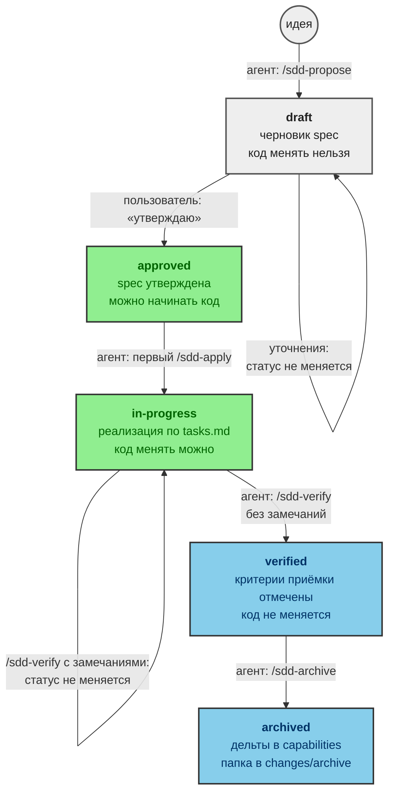
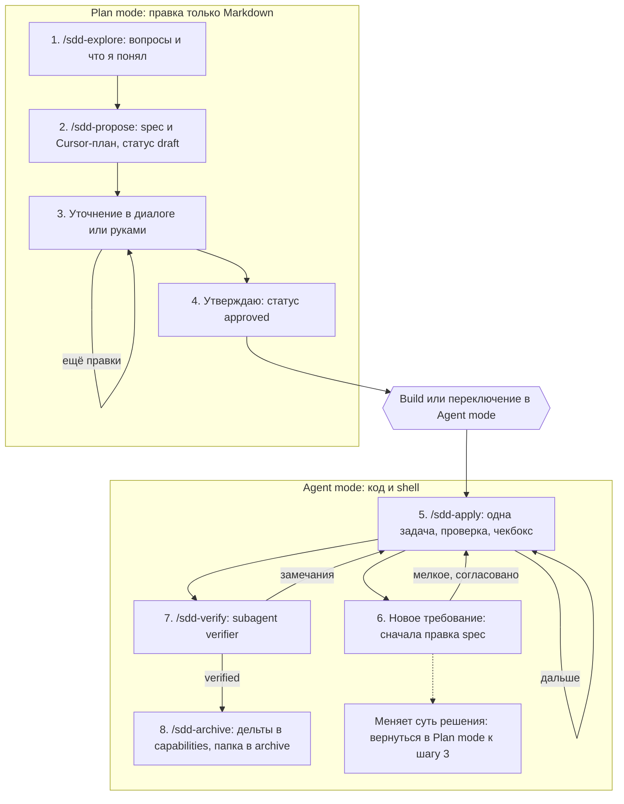

# Спецификации (SDD)

Каталог хранит требования к проекту и изменения, которые проходят процесс
разработки по спецификациям (Spec-driven development, SDD) в Cursor. Проект
использует собственный минимальный формат по мотивам
[OpenSpec](https://openspec.dev), без CLI и внешних зависимостей.

Для нетривиального изменения сначала напишите и утвердите спецификацию, затем
меняйте код. Если требование меняется во время работы, сначала исправьте
спецификацию.

## Когда применять

Используйте SDD, если изменение:

- затрагивает больше одного файла;
- требует неочевидных решений;
- меняет поведение сборки, проверок или публикации.

SDD не нужен для мелких правок: исправления опечатки, изменения одной строки
в одном файле или редактирования README без изменения смысла.

## Структура

```text
spec/
  README.md                      # этот файл
  templates/                     # шаблоны артефактов
  capabilities/<capability>/spec.md
                                 # текущие требования = источник истины
  changes/<NNN-name>/            # активное изменение
    proposal.md                  # зачем, что, вне рамок, критерии, статус
    design.md                    # только при неочевидных решениях
    tasks.md                     # задачи, у каждой своя проверка
    plan.md                      # копия Cursor-плана (всегда после propose)
    specs/<capability>/spec.md   # дельта требований
  changes/archive/ГГГГ-ММ-ДД-<NNN-name>/
                                 # завершённые изменения
  plans/ГГГГ-ММ-ДД-<имя>.plan.md # копии Cursor-планов вне цикла SDD
```

- Имя изменения: трёхзначный порядковый номер и краткое имя в kebab-case,
  например `002-connectivity-timeout`.
- Тексты пишутся по-русски. Ключевые слова формата остаются английскими:
  `Requirement`, `Scenario`, `WHEN`, `THEN`, `AND`, `ADDED`, `MODIFIED`,
  `REMOVED`.

## Статусы изменения

Статус записывается строкой `Статус: <значение>` под заголовком `proposal.md`.
На стрелках указано, кто и какой командой меняет статус, в блоках — что
разрешено в этом статусе.



> **Важно!**
> Статус `approved` ставит только пользователь или агент по прямой просьбе
> пользователя в чате.

## Цикл работы



Режим переключается селектором под полем ввода чата или сочетанием
`Shift+Tab`.

1. **Исследование**
   - Режим: Plan mode.
   - Команда: `/sdd-explore <идея>`.
   - Агент читает код и задаёт один или два вопроса за раз. После каждого
     ответа агент кратко пересказывает, что понял.
   - Результат: файлы не создаются.
   - Вне Plan mode агент не исследует идею, но пишет, какой режим сейчас
     и что нужен Plan mode (селектор или `Shift+Tab`).
2. **Черновик**
   - Режим: Plan mode, тот же чат.
   - Команда: `/sdd-propose [NNN-name]`.
   - Результат: агент создаёт `spec/changes/NNN-name/` из шаблонов со статусом
     `draft` и всегда вызывает `CreatePlan`, чтобы в UI появилась карточка
     плана. Копия — в `plan.md` изменения.
   - Вне Plan mode агент не создаёт spec и карточку плана, но пишет,
     какой режим сейчас и что нужен Plan mode (селектор или `Shift+Tab`).
3. **Уточнение**
   - Режим: Plan mode.
   - Правьте файлы вручную или пишите в чате: «убери критерий 3», «добавь
     сценарий для недоступного сервера».
4. **Утверждение**
   - Режим: Plan mode.
   - Команда: «утверждаю».
   - Результат: агент ставит `approved`.
   - Затем перейдите в Agent mode одним из способов:
     - кнопкой **Build** под Cursor-планом — реализация стартует сразу;
     - вручную селектором режима — затем `/sdd-apply` в этом или новом чате.
5. **Реализация**
   - Режим: Agent mode.
   - Команда: `/sdd-apply NNN-name [задача]`.
   - Агент работает по `tasks.md`, а не по списку задач Cursor-плана.
   - Агент выполняет задачу или группу, запускает проверку, отмечает чекбокс
     и останавливается с отчётом до команды «дальше».
   - По команде «делай всё до конца» агент продолжает работу без
     промежуточных остановок.
   - Работу останавливают непройденная проверка, новое требование или задача
     «Требует подтверждения».
6. **Новое требование**
   - Режим: Agent mode.
   - Агент не расширяет код молча, а предлагает изменить спецификацию и ждёт
     согласия.
   - Если меняется суть решения, вернитесь в Plan mode к шагу 3.
7. **Проверка**
   - Режим: Agent mode.
   - Команда: `/sdd-verify NNN-name`.
   - Вспомогательный агент `verifier` сверяет изменения с критериями приёмки
     и разделом «Вне рамок». В рамках этой команды агент замечания не
     исправляет.
   - Замечаний нет: критерии приёмки отмечаются `- [x]`, статус становится
     `verified`, можно архивировать.
   - Есть замечания: статус остаётся `in-progress`, чекбоксы критериев
     не отмечаются. Агент перечисляет замечания с путём и способом проверки
     и предлагает `/sdd-apply`. После правок `/sdd-verify` запускают снова.
     Цикл «замечания → apply → verify» повторяется, пока замечаний не
     останется.
   - Если замечание показывает, что неверен сам критерий или решение,
     сначала правьте spec (шаг 3 или 6), затем снова apply и verify.
     Код «под отчёт» без правки spec не подгоняют.
8. **Архивация**
   - Режим: Agent mode.
   - Команда: `/sdd-archive NNN-name`.
   - Результат: дельты вливаются в `capabilities/`, папка переносится
     в `changes/archive/`.

> **Примечание.**
> Plan mode технически запрещает агенту менять что-либо, кроме Markdown.
> Поэтому шаги 1–4 надёжнее выполнять именно в нём: код гарантированно не
> будет изменён до утверждения.

> **Внимание!**
> Задачи с пометкой «Требует подтверждения» (RouterOS-устройства, `push`,
> release или deploy) агент выполняет только после отдельного явного согласия
> в чате.

### Отметка шага SDD

Навыки `sdd-*` можно включать как Custom Mode в окне Agents или Cursor CLI.
Так выбранный шаг остаётся в контексте сессии и отображается в поле ввода.
Обычный вызов через `/` прикрепляет навык только к одному сообщению.

Рекомендуемый порядок: `sdd-propose` в Plan mode, `sdd-apply` после
утверждения и `sdd-verify` перед архивацией. Режим не читает статус
из `proposal.md`; в новом чате выберите его заново.

## Сквозной пример

Изменение `001-repository-check`: добавить локальную проверку обязательного
файла.

1. В Plan mode выполните `/sdd-explore добавить проверку обязательного файла`.
2. После уточнения имени файла выполните
   `/sdd-propose 001-repository-check`. Появится изменение со статусом
   `draft`.
3. Проверьте критерии и напишите «утверждаю». Статус станет `approved`.
4. В Agent mode выполните `/sdd-apply 001-repository-check`. Агент изменит
   `tools/check-repository.sh`, запустит локальную проверку и отметит шаг.
5. Выполните `/sdd-verify 001-repository-check`. При отсутствии замечаний
   статус станет `verified`.
6. Выполните `/sdd-archive 001-repository-check`. Дельта попадёт
   в `spec/capabilities/`, а изменение — в `spec/changes/archive/`.

## Формат дельты требований

```markdown
## ADDED Requirements

### Requirement: Краткое название

Описание требования.

#### Scenario: Краткое название сценария

- WHEN условие
- THEN ожидаемый результат
- AND дополнительный результат
```

- `ADDED` — новое требование.
- `MODIFIED` — требование приводится целиком в новой редакции; название
  совпадает с текущим в `capabilities/`.
- `REMOVED` — указываются название и причина удаления.

## Cursor-планы

Каждый `*.plan.md`, созданный в Plan mode, сразу сохраняется копией в
репозиторий:

- план изменения — в `spec/changes/<NNN-name>/plan.md`;
- остальные планы — в `spec/plans/ГГГГ-ММ-ДД-<краткое-имя>.plan.md`.

Копия содержит весь план, включая метаданные frontmatter и список задач
(`todos`). Она обновляется после каждой правки плана и по завершении
реализации. Правило закреплено в [`AGENTS.md`](../AGENTS.md).

## Связанные файлы Cursor

- [`.cursor/rules/sdd.mdc`](../.cursor/rules/sdd.mdc) — правила для файлов
  `spec/**`;
- `.cursor/skills/sdd-*/SKILL.md` — команды `/sdd-explore`, `/sdd-propose`,
  `/sdd-apply`, `/sdd-verify`, `/sdd-archive`;
- [`.cursor/agents/verifier.md`](../.cursor/agents/verifier.md) — независимая
  проверка изменений.
