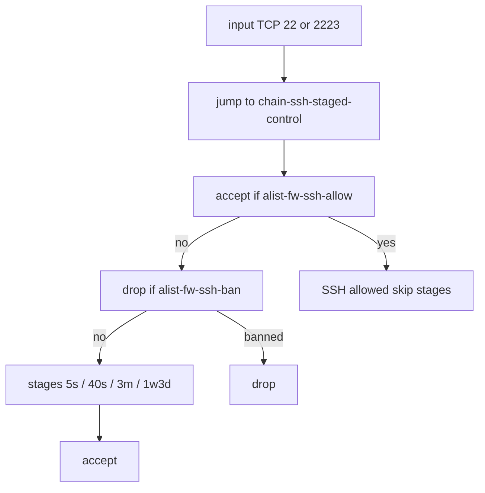

# 001-ssh-fw-unify: проектное решение

## Контекст

Снимки `src/config` (`9a198a1`). Служба SSH уже `2223` на обоих.

Сейчас SSH-filter размазаны: WAN-drop на `anna`, input/forward ban без порта,
jump без порта на `anna`, accept в `chain-self-common-ports`, стадии с
`dst-port` на `anna`. Бан без порта не режет Winbox только потому, что
Winbox accept стоит раньше.

Knock: anna/capxl вызывают `$globalKnockKnock`; писатель `$globalApplyKnock`
живёт на chr и сейчас пишет `alist-fw-knockknock`. Первый SSH knock идёт с
WAN IP, которого ещё нет в листе.

## Решение

Все SSH-filter — только в `chain-ssh-staged-control`. Вход: jump из `input`
с `protocol=tcp dst-port=22,2223`.

Порядок внутри:

1. `accept src-address-list=alist-fw-ssh-allow`
2. `drop src-address-list=alist-fw-ssh-ban`
3. стадии 5 с / 40 с / 3 мин / 1w3d, `!alist-fw-ssh-allow`, без `dst-port`
4. `accept` (неизбранный, ещё не в бане)

Финальный accept внутри цепочки, не `return` в common-ports. Иначе после
снятия SSH из common-ports неизбранный (и knock) упрётся в
`Drop all other WAN Traffic`.

Одинаково на `anna` и `chr`. Снять: WAN-drop SSH на `anna`; input и forward
drop `alist-fw-ssh-ban`; SSH tcp/udp в `chain-self-common-ports`; `5022` из
jump и из chr log forward.

Forward ssh-ban в цепочку не переносится: jump forward `22,2223` застейджит
исходящий SSH с LAN. Правило снимаем на обоих.

Winbox-правила не меняем. Jump SSH не включает `8291`.

Скрипт: `$globalApplyKnock` пишет `alist-fw-ssh-allow`. Выкат писателя
сначала на chr. На время Fresh — dual-list, затем один лист.

`/ip ssh set password-authentication=yes` только на `anna` (не filter).
У пользователя с ключом пароль этому пользователю может по-прежнему не
приниматься.

Порядок live: Safe Mode, текущую сессию не рвать; на каждом устройстве
финальный accept в цепочке и снятие SSH из common-ports в одном окне, затем
новый коннект :2223 и Winbox LAN. Сначала chr, затем anna.

## Отвергнутые альтернативы

- Accept только allow-list, неизбранный drop — ломает первый SSH knock на chr.
- WAN-drop SSH на anna с `!alist-fw-ssh-allow` — device-custom, оператор
  запретил.
- `dst-port` на стадиях «на всякий случай» — оператор оставил порт только
  на jump.
- Сузить input ssh-ban портом, оставив правило в `input` — бан остаётся вне
  custom chain; Winbox живёт случайным порядком accept.
- Оставить SSH в common-ports — второй accept снаружи цепочки.

## Риски

- Сканер на :2223 получает живой SSH до бана (5 с / 40 с / 3 мин). Снижение:
  стадии chr, ключ, пароль не для WAN-мира как модель «закрыто». Сознательно
  ради knock.
- Снятие common-ports раньше финального accept в цепочке отрежет текущую
  сессию. Снижение: порядок шага, Safe Mode, проверка новым коннектом.
- Fresh скрипта на chr позже firewall — knock пишет не в тот лист. Снижение:
  dual-list на переход, писатель первым.
- Полный `alist-fw-ssh-ban` knock не снимает. Снижение: вне рамок, знать при
  диагностике.
