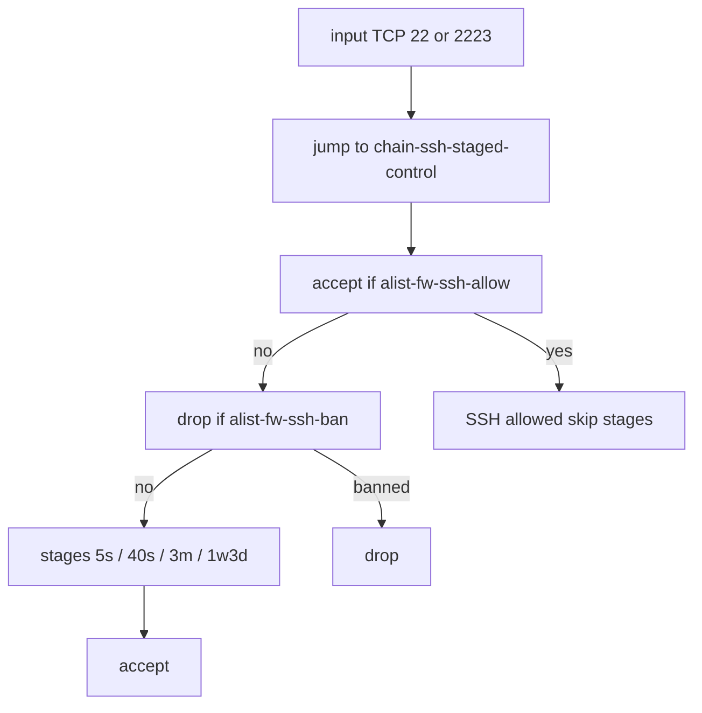

# Синхронизация SSH-защиты anna/chr

Черновик SDD (`draft`): [proposal.md](proposal.md), [design.md](design.md), [tasks.md](tasks.md), [ssh-firewall](specs/ssh-firewall/spec.md). Код и устройства не трогать до «утверждаю».

Источник — снимки `src/config` (`9a198a1`). К устройствам в этом плане не подключаемся.

Единые правила на обоих. Без точечных исключений «только anna» / «только chr», кроме переходного dual-list на время выката скрипта (потом снимается).

**Решение оператора:** неизбранный SSH до бана принимается. Первый knock-SSH на chr проходит. WAN без листа не молчит — мир стучится, пока не наберёт стадии и `alist-fw-ssh-ban`.

## LAN-статика

На anna `alist-fw-ssh-allow` уже содержит LAN /24. Не дублировать. Эти IP идут в первое `accept` цепочки и не стейджатся.

## Все SSH-filter — в `chain-ssh-staged-control`

Сейчас вне цепочки:

- **input drop `alist-fw-ssh-ban` без порта** — режет весь input. Winbox жив, потому что его accept раньше. Перенос drop **внутрь** SSH-цепочки + jump только `22,2223`: Winbox в цепочку не входит. Правила Winbox не меняем.
- **forward drop `alist-fw-ssh-ban`** — кара транзиту, не SSH роутера. В input-цепочку не переносится (застейджится исходящий SSH с LAN). Едино: **снять на обоих**.
- **anna WAN-drop SSH** — device-custom, **снимаем**. На chr его нет.
- **common-ports accept SSH tcp и udp `22,2223`** — обязательно **удалить на обоих**. Иначе после цепочки пакет всё равно примется снаружи, и «все SSH-filter в цепочке» ложно. Accept неизбранных — только последнее правило внутри `chain-ssh-staged-control`. UDP-accept SSH не переносим.
- **chr log forward `22,5022`** — не filter. Из match убрать `5022`.
- **jump** в `input`: `protocol=tcp dst-port=22,2223` (без `5022`). На anna сейчас jump без порта — это уйдёт.

`/ip service set ssh port=2223` и `/ip ssh` (пароль на anna) — не filter, снаружи.

## Целевая цепочка (оба)

Jump: `chain=input protocol=tcp dst-port=22,2223` → `chain-ssh-staged-control`.

Внутри, сверху вниз:

1. `accept src-address-list=alist-fw-ssh-allow`
2. `drop src-address-list=alist-fw-ssh-ban`
3. stage3→ban 1w3d, stage2→3 3m, stage1→2 40s, stage0→1 5s, `src-address-list=!alist-fw-ssh-allow`, **без dst-port**
4. `accept` (остальной SSH, который дошёл сюда: неизбранный и ещё не в бане)

Нет `return` в common-ports. Нет dst-port на stage.

Winbox в jump не входит.

Переходный dual-list (`knockknock` + `ssh-allow`) на время выката скрипта, затем один `alist-fw-ssh-allow`. Статику с knockknock на chr перенести.

## Риск этого режима

Сканер на `:2223` получает живой SSH, пока не пройдёт 5s → 40s → 3m. Пароль на anna это усиливает. Allow-list только ускоряет своих, не закрывает чужих. Это сознательно, чтобы knock/backup не умерли.

## Winbox (только оценка)

Не меняем. anna: WAN Winbox drop, LAN accept раньше. chr: ранний accept 8291. Позже по образу SSH можно jump `8291` и бан внутри — не в этом выкате.

## Скрипт (отдельный коммит)

[`doEnvironmentSetup.rsc.txt`](../../../src/scripts/doEnvironmentSetup.rsc.txt): `$globalApplyKnock` пишет `alist-fw-ssh-allow`. Клиенты dump/backup/DNS не менять. Доки: [`doc/operations/backup-pipeline.md`](../../../doc/operations/backup-pipeline.md), [`doc/style-canon.md`](../../../doc/style-canon.md).

Писатель — **chr**. Канон в Git; live filter — SSH.

## Выкат

SDD `spec/changes/001-ssh-fw-unify/`. Safe Mode, сессию не рвать, новый SSH 2223 + Winbox LAN после каждого устройства.

1. Одинаковый firewall: chr, затем anna. На каждом шаге: снять SSH из `chain-self-common-ports` (tcp и udp) **до или вместе** с появлением финального `accept` в SSH-цепочке — не оставлять дыру и не отрезать сессию. `password-authentication=yes` только anna, это `/ip ssh`.
2. Скрипт → `_autobranch` → merge `master`.
3. Fresh+env: chr, потом anna, capxl.
4. Снять dual-list. Backup, снимки.

capxl: firewall SSH не трогаем.

## Вне рамок

- Перепись Winbox.
- Firewall SSH на capxl.
- Снятие ssh-ban из knock.
- Правка портов port-knock chr (`3006` vs `30004/30005/30006`).
- Device-custom без нового согласия.
- Allow-list-only (отклонено: ломает knock).
